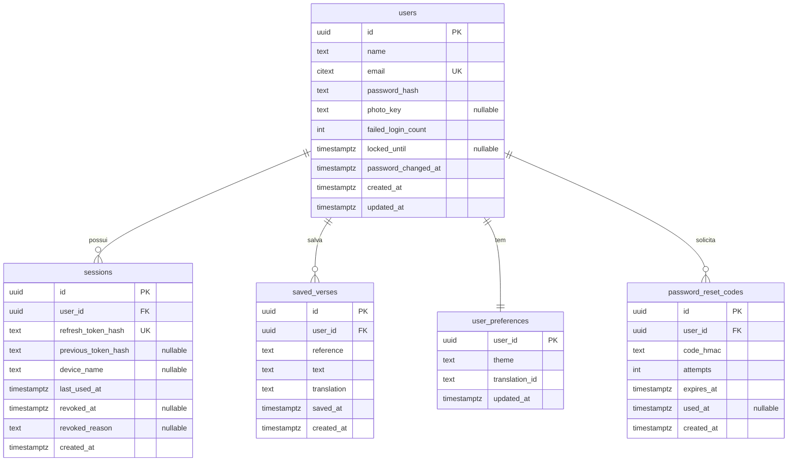
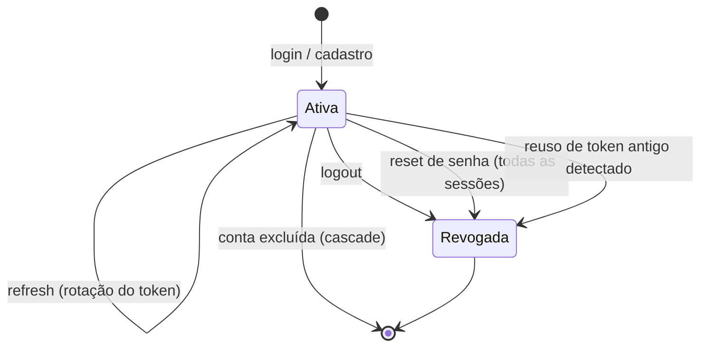

# Data Model: Autenticação de Usuário & Dados Salvos por Conta

**Feature**: `005-user-auth` | **Date**: 2026-10-14 | **Banco**: PostgreSQL 17 | **ORM**: Prisma

Convenções (skill `postgres-expert-antigravity`): tabelas em `snake_case` plural, PK `id uuid`, FKs `<singular>_id`, timestamps `timestamptz`, `text` em vez de `varchar(n)` (limites validados na API e por `CHECK`).

---

## Diagrama



---

## Entidades

### `users`

| Coluna | Tipo | Regras |
|---|---|---|
| `id` | `uuid` PK | `gen_random_uuid()`. Não sequencial (prevenção de IDOR) |
| `name` | `text` NOT NULL | 2–80 caracteres após `trim` (FR-004). Aceita acentos e emojis |
| `email` | `citext` NOT NULL **UNIQUE** | Normalizado `trim().toLowerCase()` na API. O tipo `citext` garante unicidade sem diferenciar maiúsculas (FR-003). Requer `CREATE EXTENSION citext` |
| `password_hash` | `text` NOT NULL | Argon2id (R4). Nunca devolvido pela API (FR-014) |
| `photo_key` | `text` NULL | Chave do arquivo no `StorageService`. NULL = avatar de iniciais (FR-026) |
| `failed_login_count` | `int` NOT NULL DEFAULT 0 | Zera em login bem-sucedido |
| `locked_until` | `timestamptz` NULL | Bloqueio temporário (FR-009) |
| `password_changed_at` | `timestamptz` NOT NULL DEFAULT now() | Auditoria |
| `created_at` / `updated_at` | `timestamptz` NOT NULL | `updated_at` via `@updatedAt` do Prisma |

**Índices**: único em `email`.
**Exclusão (FR-029)**: `DELETE` em cascata para todas as tabelas filhas, mais remoção do arquivo de foto.

### `sessions`

Uma linha por aparelho logado (R5).

| Coluna | Tipo | Regras |
|---|---|---|
| `id` | `uuid` PK | Vai no JWT como `sid` |
| `user_id` | `uuid` FK → `users.id` **ON DELETE CASCADE** | |
| `refresh_token_hash` | `text` NOT NULL UNIQUE | SHA-256 (hex) do refresh token atual |
| `previous_token_hash` | `text` NULL | Hash do token anterior, para **detectar reuso** |
| `device_name` | `text` NULL | Ex.: "Pixel 8 · Android 15" (informativo, ≤ 100 caracteres) |
| `last_used_at` | `timestamptz` NOT NULL | Atualizado a cada refresh |
| `revoked_at` | `timestamptz` NULL | Preenchido = sessão morta |
| `revoked_reason` | `text` NULL | `CHECK IN ('logout','password_reset','account_deleted','token_reuse')` |
| `created_at` | `timestamptz` NOT NULL | |

**Índices**: `user_id`; parcial `(user_id) WHERE revoked_at IS NULL` para revogação em massa.

**Estados**:

> Não existe estado "Expirada": decisão Q3 = C.

### `saved_verses`

| Coluna | Tipo | Regras |
|---|---|---|
| `id` | `uuid` PK | **Gerado pelo app** (R8), o que garante PUT idempotente |
| `user_id` | `uuid` FK → `users.id` ON DELETE CASCADE | |
| `reference` | `text` NOT NULL | 1–100 caracteres (ex.: "João 3:16") |
| `text` | `text` NOT NULL | 1–5.000 caracteres |
| `translation` | `text` NOT NULL | 1–32 caracteres, `^[a-z0-9-]+$` (ex.: `almeida`) |
| `saved_at` | `timestamptz` NOT NULL | Horário em que o usuário salvou (vem do app; o servidor limita a `<= now()`) |
| `created_at` | `timestamptz` NOT NULL | Chegada no servidor |

**Índices**: **UNIQUE (`user_id`, `reference`, `translation`)** (FR-021); `(user_id, saved_at DESC)` para listagem.

### `user_preferences`

| Coluna | Tipo | Regras |
|---|---|---|
| `user_id` | `uuid` PK + FK ON DELETE CASCADE | Relação 1:1 |
| `theme` | `text` NOT NULL DEFAULT `'dark'` | `CHECK IN ('light','dark','system')`. Bate com `ThemeMode` em `src/types/index.ts` |
| `translation_id` | `text` NOT NULL DEFAULT `'almeida'` | Mesmo formato de `saved_verses.translation` |
| `updated_at` | `timestamptz` NOT NULL | Última escrita vence (R8) |

Criada junto com o usuário no cadastro (mesma transação).

### `password_reset_codes`

| Coluna | Tipo | Regras |
|---|---|---|
| `id` | `uuid` PK | |
| `user_id` | `uuid` FK ON DELETE CASCADE | |
| `code_hmac` | `text` NOT NULL | HMAC-SHA256(pepper, código). Nunca guardar o código em texto |
| `attempts` | `int` NOT NULL DEFAULT 0 | 5 → código invalidado (FR-028b) |
| `expires_at` | `timestamptz` NOT NULL | `created_at + 15 min` |
| `used_at` | `timestamptz` NULL | Uso único |
| `created_at` | `timestamptz` NOT NULL | Conta para o limite de 3 pedidos / 15 min |

**Regra**: um novo pedido invalida os códigos anteriores ainda ativos do usuário. **Índice**: `(user_id, created_at DESC)`.
**Limpeza**: códigos com mais de 24 h podem ser apagados por um job simples (fora do caminho crítico).

---

## Modelo local (app)

Os dados locais não vão para o Postgres. Ficam no AsyncStorage (R7) e no SecureStore (R6).

| Chave | Onde | Conteúdo | Ciclo de vida |
|---|---|---|---|
| `auth.refreshToken` | SecureStore | refresh token opaco | Criado no login; apagado no logout ou revogação |
| `guest-data` | AsyncStorage | `{ savedVerses: SavedVerse[], theme, translationId }` | Permanente; **nunca** enviado ou migrado (Q1 = B) |
| `account-cache:<userId>` | AsyncStorage | `{ user, savedVerses, preferences, outbox: PendingOp[] }` | Apagado no logout ou troca de usuário (FR-019) |

```ts
// Tipo de referência (src/types/account.ts). O app usa o tipo SavedVerse atual + id.
type PendingOp =
  | { kind: 'upsertVerse'; verse: AccountSavedVerse; attempts: number }
  | { kind: 'deleteVerse'; id: string; attempts: number }
  | { kind: 'updatePreferences'; patch: Partial<Preferences>; attempts: number };
```

**Mudança no tipo existente**: `SavedVerse` (`src/types/index.ts`) ganha `id: string` (UUID). A remoção passa a ser por `id`, e não mais por `reference`, porque a mesma referência pode existir em traduções diferentes.
