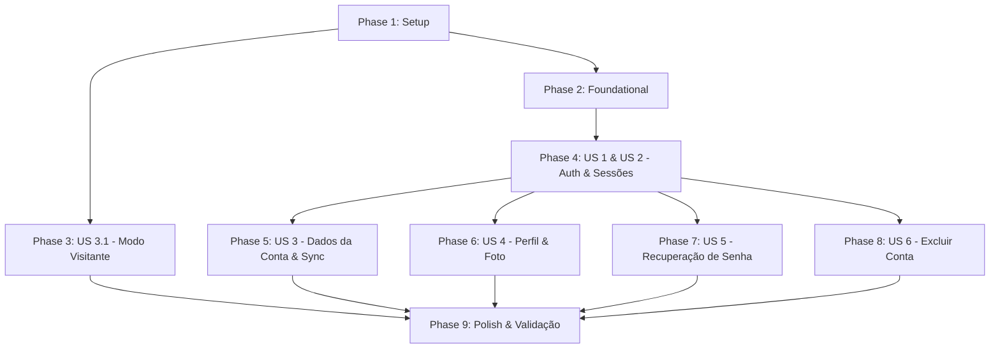

# Tasks: Autenticação de Usuário & Dados Salvos por Conta

**Feature**: `005-user-auth`  
**Input**: Feature Specification ([spec.md](./spec.md)), Implementation Plan ([plan.md](./plan.md)), Data Model ([data-model.md](./data-model.md)), API Contracts ([contracts/api.md](./contracts/api.md)), UI Contracts ([contracts/app-ui.md](./contracts/app-ui.md)), Quickstart ([quickstart.md](./quickstart.md)).

---

## Phase 1: Setup (Shared Infrastructure & Environment)

**Purpose**: Inicialização das ferramentas de backend, contêineres Docker locais e isolamento do bundler Metro.

- [x] T001 Criar arquivo de orquestração Docker para PostgreSQL 17 Alpine e Mailpit em docker-compose.yml
- [x] T002 Criar template de variáveis de ambiente do Docker em .env.docker.example e documentar em .env.example
- [x] T003 [P] Criar metro.config.js com blockList para impedir que o bundler do Expo indexe a pasta api/
- [x] T004 [P] Inicializar projeto NestJS 11 em api/package.json com TypeScript strict e scripts de build/dev
- [x] T005 [P] Configurar regras do agente e padrões de desenvolvimento em api/AGENTS.md
- [x] T006 [P] Configurar tsconfig.json e nest-cli.json em api/
- [x] T007 [P] Criar Dockerfile multi-stage com usuário não-root (node) e .dockerignore em api/Dockerfile
- [x] T008 Instalar dependências da API (NestJS, Prisma, Argon2, class-validator, helmet, etc.) em api/package.json

---

## Phase 2: Foundational (Blocking Prerequisites)

**Purpose**: Infraestrutura de dados, módulo base do Prisma e camada de envelope HTTP compartilhada.

**⚠️ CRITICAL**: Nenhuma história de usuário que dependa do servidor pode ser iniciada antes da conclusão desta fase.

- [x] T009 Configurar schema do Prisma com tabelas users, sessions, saved_verses, user_preferences, password_reset_codes e extensão citext em api/prisma/schema.prisma
- [x] T010 Criar serviço e módulo de conexão PrismaService em api/src/prisma/prisma.service.ts e api/src/prisma/prisma.module.ts
- [x] T011 [P] Implementar validação de variáveis de ambiente com Joi/Zod em api/src/config/env.validation.ts
- [x] T012 [P] Implementar filtro global de exceções HttpExceptionFilter para padronizar respostas `{ error: { code, message, details } }` em api/src/common/filters/http-exception.filter.ts
- [x] T013 [P] Implementar interceptor global TransformInterceptor para padronizar respostas `{ data: T }` em api/src/common/interceptors/transform.interceptor.ts
- [x] T014 [P] Implementar decorators @Public() e @CurrentUser() em api/src/common/decorators/
- [x] T015 [P] Implementar JwtAuthGuard global com estratégia default-deny em api/src/common/guards/jwt-auth.guard.ts
- [x] T016 Configurar bootstrap global (Helmet, CORS, ValidationPipe com whitelist/transform, prefixo /api/v1) em api/src/main.ts
- [x] T017 [P] Implementar endpoint de health check público em api/src/health/health.controller.ts

**Checkpoint**: Infraestrutura de banco e API pronta e testável via `GET /api/v1/health`.

---

## Phase 3: User Story 3.1 - Modo Visitante Persistido no App (Priority: P1) 🎯 MVP 1 (Local)

**Goal**: Garantir que o usuário visitante possa ler, favoritar versículos, trocar tema e tradução, com dados persistidos no celular via AsyncStorage sem depender de backend.

**Independent Test**: Abrir o app novo → favoritar versículos → alterar tema/tradução → fechar o app completamente → reabrir → dados continuam intactos no aparelho (Cenário V1 do quickstart).

- [x] T018 Instalar dependência @react-native-async-storage/async-storage no app em package.json
- [x] T019 [P] [US3.1] Atualizar interface SavedVerse em src/types/index.ts adicionando campo id (UUID)
- [x] T020 [P] [US3.1] Criar adaptador de persistência com namespace em src/services/storage/asyncStorage.ts
- [x] T021 [US3.1] Criar useGuestStore com Zustand persistido sob namespace guest-data em src/stores/useGuestStore.ts
- [x] T022 [P] [US3.1] Criar hook de fachada usePreferences para expor tema e tradução ativa em src/hooks/usePreferences.ts
- [x] T023 [P] [US3.1] Criar hook de fachada useSavedVerses para expor listagem, adição e remoção por id em src/hooks/useSavedVerses.ts
- [x] T024 [US3.1] Refatorar useTheme para consumir as preferências através do hook usePreferences em src/hooks/useTheme.ts
- [x] T025 [US3.1] Atualizar VerseOfTheDayCard para usar useSavedVerses e usePreferences em src/components/features/bible/VerseOfTheDayCard.tsx
- [x] T026 [US3.1] Atualizar SettingsTranslationList para usar usePreferences em src/components/features/bible/SettingsTranslationList.tsx
- [x] T027 [US3.1] Atualizar WelcomeScreen e BibleSearchScreen para usar useSavedVerses e usePreferences em src/screens/

**Checkpoint**: O app agora é 100% resiliente ao fechamento mesmo sem conta ou backend rodando!

---

## Phase 4: User Story 1 - Criar Conta (Priority: P1) & User Story 2 - Login e Sessão (Priority: P1)

**Goal**: Permitir criação de conta com nome, e-mail e senha, autenticação com JWT e refresh tokens rotativos no servidor e no app com persistência segura no aparelho.

**Independent Test**: Criar nova conta pelo app → verificar sessão ativa e saudação personalizada → fechar e reabrir app → continuar logado sem pedir senha → efetuar logout e voltar ao modo visitante (Cenários V2, V5 e V6).

### Backend (Auth & Sessions)
- [x] T028 [P] [US1] Implementar serviço de hash e verificação Argon2id em api/src/auth/password.service.ts
- [x] T029 [P] [US1] Criar DTOs de cadastro e login (RegisterDto, LoginDto) com validações em api/src/auth/dto/
- [x] T030 [US2] Implementar SessionsService com geração de refresh token opaco, hash SHA-256 e rotação com detecção de reuso em api/src/auth/sessions.service.ts
- [x] T031 [US1] Implementar AuthService (registro atômico com usuário, preferências padrão e sessão) em api/src/auth/auth.service.ts
- [x] T032 [US2] Implementar bloqueio por força bruta (5 falhas / 15 min) e mitigação contra enumeração de usuários em api/src/auth/auth.service.ts
- [x] T033 [US2] Implementar endpoints POST /auth/register, POST /auth/login, POST /auth/refresh e POST /auth/logout em api/src/auth/auth.controller.ts
- [x] T034 [P] [US2] Configurar ThrottlerModule com rate limit estrito nas rotas de autenticação em api/src/app.module.ts

### App (Cliente, Armazenamento Seguro e Telas)
- [x] T035 [P] [US2] Instalar expo-secure-store e expo-crypto no app em package.json
- [x] T036 [P] [US2] Implementar secureTokenStorage para salvar e recuperar refresh token criptografado em src/services/storage/secureTokenStorage.ts
- [x] T037 [US2] Implementar apiClient com interceptor de Bearer token e refresh automático single-flight em src/services/api/apiClient.ts
- [x] T038 [P] [US1] Implementar cliente de API authApi com register, login, refresh e logout em src/services/api/authApi.ts
- [x] T039 [US2] Criar useSessionStore com Zustand para gerenciar status (booting, guest, authenticated), user e access token em memória em src/stores/useSessionStore.ts
- [x] T040 [US2] Criar hook useSessionBootstrap para inicializar sessão na inicialização do app em src/hooks/useSessionBootstrap.ts
- [x] T041 [P] [US1] Criar componente visual PasswordField com alternador de visibilidade nos tokens pasteis em src/components/ui/PasswordField.tsx
- [x] T042 [P] [US1] Criar componente FormError para exibição de mensagens de validação em src/components/ui/FormError.tsx
- [x] T043 [US1] Implementar tela SignUpScreen com validação de senha em tempo real e aviso de não-migração de favoritos em src/screens/auth/SignUpScreen.tsx
- [x] T044 [US2] Implementar tela SignInScreen com tratamento de bloqueio temporário e navegação para recuperação em src/screens/auth/SignInScreen.tsx
- [x] T045 [US2] Atualizar RootNavigator e navegação tipada adicionando rotas modais de SignIn e SignUp em src/navigation/
- [x] T046 [US2] Atualizar SideDrawer para exibir botão 'Entrar / Criar conta' (visitante) ou nome/avatar com botão de logout em src/components/ui/SideDrawer.tsx

**Checkpoint**: Cadastro, login, logout e permanência de sessão 100% funcionais de ponta a ponta.

---

## Phase 5: User Story 3 - Dados Salvos por Usuário & Sincronização Offline (Priority: P1)

**Goal**: Persistir versículos favoritos, tema e tradução preferida vinculados à conta do usuário no PostgreSQL com sincronização offline transparente.

**Independent Test**: Salvar versículos e alterar tema em um aparelho → logar em outro aparelho → dados aparecem sincronizados; salvar em modo avião → reconectar → dados sobem para a API em até 30s (Cenários V4 e V8).

### Backend (Endpoints de Usuário)
- [x] T047 [P] [US3] Implementar PreferencesService e PreferencesController para GET /me/preferences e PUT /me/preferences em api/src/preferences/
- [x] T048 [P] [US3] Implementar SavedVersesService e SavedVersesController com PUT idempotente por UUID e DELETE em api/src/saved-verses/
- [x] T049 [US3] Garantir isolamento multitenant estrito (@CurrentUser('id')) contra IDOR e resposta sem duplicação de versículos em api/src/saved-verses/

### App (Cache, Outbox e Integração)
- [x] T050 [P] [US3] Instalar @react-native-community/netinfo no app em package.json
- [x] T051 [P] [US3] Implementar accountApi com endpoints de preferências e versículos em src/services/api/accountApi.ts
- [x] T052 [US3] Criar useAccountCacheStore com cache isolado por userId e fila outbox persistida em src/stores/useAccountCacheStore.ts
- [x] T053 [US3] Atualizar hooks de fachada useSavedVerses e usePreferences para alternar entre useGuestStore e useAccountCacheStore conforme useSessionStore em src/hooks/
- [x] T054 [US3] Implementar hook useOutboxSync para processamento e reenvio automático da fila offline ao reconectar em src/hooks/useOutboxSync.ts
- [x] T055 [US3] Integrar useOutboxSync e bootstrap na raiz do app em App.tsx

**Checkpoint**: Sincronização de dados da conta e suporte offline concluídos com sucesso.

---

## Phase 6: User Story 4 - Perfil e Foto do Usuário (Priority: P2)

**Goal**: Permitir visualização do perfil, edição de nome, upload de foto segura com processamento no servidor e remoção de foto.

**Independent Test**: Abrir perfil do usuário → selecionar foto da galeria → foto é exibida com corte 1:1 e avatar atualizado → remover foto → avatar exibe iniciais (Cenários V9 e V10).

### Backend (Storage & Processamento de Imagens)
- [ ] T056 [P] [US4] Implementar StorageService com driver local para gravação e deleção segura em api/src/storage/storage.service.ts
- [ ] T057 [US4] Configurar upload com verificação de magic bytes (file-type), reprocessamento via Sharp (512x512 WEBP, strip EXIF) e limite de 5MB em api/src/users/users-photo.service.ts
- [ ] T058 [US4] Implementar endpoints GET /me, PATCH /me, PUT /me/photo e DELETE /me/photo em api/src/users/users.controller.ts
- [ ] T059 [P] [US4] Configurar rota estática pública para servir avatares /files/avatars/:file com header de cache imutável em api/src/main.ts

### App (Componentes e Tela de Perfil)
- [ ] T060 [P] [US4] Instalar expo-image-picker, expo-image-manipulator e expo-image em package.json
- [ ] T061 [P] [US4] Criar componente Avatar com suporte a imagem com cache ou iniciais do nome nos tons pasteis em src/components/ui/Avatar.tsx
- [ ] T062 [US4] Criar hook useCurrentUser para expor dados do usuário ativo e função de atualização em src/hooks/useCurrentUser.ts
- [ ] T063 [US4] Implementar tela ProfileScreen com edição de nome, seleção de foto e feedback visual em src/screens/ProfileScreen.tsx
- [ ] T064 [US4] Adicionar rota de Profile no RootNavigator e link direto no cabeçalho/SideDrawer em src/navigation/

**Checkpoint**: Perfil completo com upload de avatar seguro e ágil.

---

## Phase 7: User Story 5 - Recuperação de Senha por E-mail (Priority: P2)

**Goal**: Permitir que usuários que esqueceram a senha solicitem código de 6 dígitos enviado por e-mail e redefinam a senha, revogando todas as sessões anteriores.

**Independent Test**: Solicitar código de recuperação na tela de login → capturar código no Mailpit local → digitar código e nova senha → logar com sucesso e constatar revogação de outros aparelhos (Cenários V11 e V12).

### Backend (Mail & Reset Codes)
- [ ] T065 [P] [US5] Implementar MailService usando Nodemailer configurado para Mailpit local ou SMTP em api/src/mail/mail.service.ts
- [ ] T066 [US5] Implementar ResetCodesService com geração de código de 6 dígitos, hash HMAC-SHA256 com pepper e controle de tentativas em api/src/auth/reset-codes.service.ts
- [ ] T067 [US5] Implementar endpoints POST /auth/password/forgot (anti-enumeração) e POST /auth/password/reset (revogação total de sessões) em api/src/auth/auth.controller.ts

### App (Telas de Recuperação)
- [ ] T068 [P] [US5] Implementar tela ForgotPasswordScreen com envio de e-mail e navegação suave em src/screens/auth/ForgotPasswordScreen.tsx
- [ ] T069 [US5] Implementar tela ResetPasswordScreen com campo de código numérico de 6 dígitos e redefinição de senha em src/screens/auth/ResetPasswordScreen.tsx
- [ ] T070 [US5] Adicionar rotas ForgotPassword e ResetPassword no RootNavigator em src/navigation/RootNavigator.tsx

**Checkpoint**: Recuperação de senha completa com e-mail simulado e revogação em cascata.

---

## Phase 8: User Story 6 - Excluir Conta & LGPD (Priority: P3)

**Goal**: Permitir exclusão voluntária da conta e de todos os dados e fotos do usuário mediante confirmação de senha.

**Independent Test**: Abrir perfil → solicitar exclusão de conta → confirmar com senha → conta apagada do banco, foto removida do disco e app retorna ao modo visitante (Cenário V14).

- [ ] T071 [US6] Implementar endpoint DELETE /me com verificação de senha e deleção em cascata no Prisma e remoção do arquivo de foto em api/src/users/users.service.ts
- [ ] T072 [US6] Adicionar modal de confirmação com inserção de senha e fluxo de exclusão em src/screens/ProfileScreen.tsx

**Checkpoint**: Conformidade total com a LGPD e encerramento limpo da conta.

---

## Phase 9: Polish & Cross-Cutting Concerns

**Purpose**: Verificações finais de qualidade, testes automatizados e validação de conformidade.

- [ ] T073 [P] Criar testes unitários para AuthService e SessionsService em api/src/auth/
- [ ] T074 [P] Criar testes e2e de autenticação, isolamento de dados e recuperação de senha em api/test/auth.e2e-spec.ts
- [ ] T075 [P] Configurar ESLint e Prettier para a API em api/.eslintrc.js e api/.prettierrc
- [ ] T076 Executar checagem de tipos estrita (npm run typecheck) no app e na API
- [ ] T077 Executar validação manual completa baseada no roteiro quickstart.md (cenários V1 a V14)

---

## Dependencies & Execution Order

### Oportunidades de Execução Paralela
- **Modo Visitante (Fase 3)** não precisa do backend rodando! Pode ser desenvolvido e testado no app imediatamente após T003/T018.
- Na **Fase 2 (Foundational)**, filtros, interceptors, guards e validações de env ([P]) podem ser codificados em paralelo.
- Na **Fase 4 (Auth)**, o desenvolvimento dos endpoints da API e os componentes visuais do app (PasswordField, FormError) podem rodar em paralelo.
- As fases de **Perfil (Fase 6)** e **Recuperação de Senha (Fase 7)** são desacopladas após a conclusão da Fase 4.

---

## Implementation Strategy

1. **MVP 1 (Resiliência do Visitante)**: Entregar a Fase 3 (Modo Visitante persistido). Imediatamente resolve a perda de favoritos ao fechar o app, sem depender de servidor.
2. **MVP 2 (Autenticação Completa)**: Subir Docker, API e implementar Fases 1, 2 e 4 (Cadastro, Login e Sessões persistentes com SecureStore).
3. **Incremento 3 (Sincronização)**: Fase 5 (Versículos e preferências salvos na conta com outbox offline).
4. **Incremento 4 (Personalização e Segurança)**: Fases 6, 7 e 8 (Foto, Recuperação e Exclusão de conta).
5. **Validação Final**: Fase 9 (Testes unitários/e2e e checklist V1 a V14).
